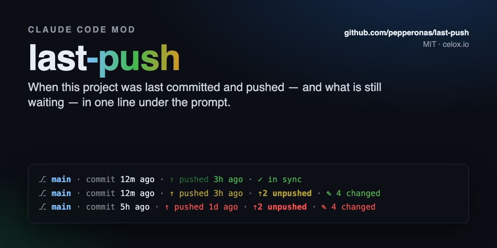
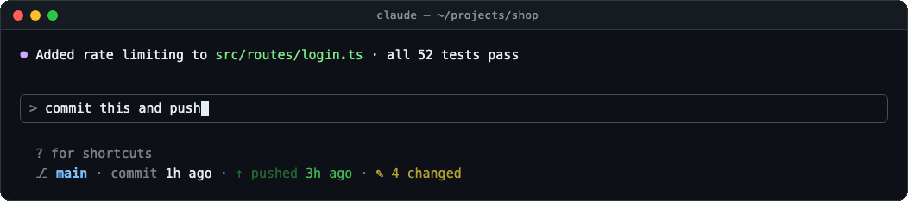
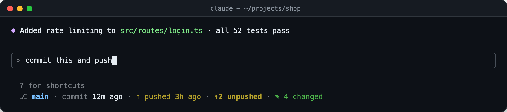
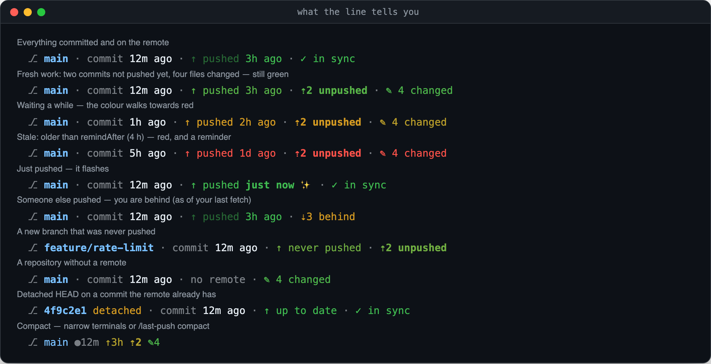
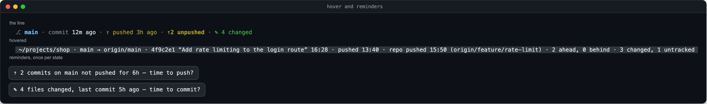

<div align="center">

<a href="https://github.com/pepperonas/last-push"></a>

# ⇡ last-push

**A Claude Code mod that shows, right under the prompt, when the project you're in was last committed and pushed — and what is still waiting: unpushed commits, uncommitted files, a colour that ages from green to red, and a nudge when work goes stale.**

<p>
  <a href="#-install"></a>
  &nbsp;
  <a href="#-demo"></a>
</p>

<h3>👉 <code>/plugin marketplace add pepperonas/last-push</code> · <code>/plugin install last-push@pepperonas-last-push</code> — that's it.</h3>

[](CHANGELOG.md)
[](tests)
[](hooks)
[](hooks)

[](https://github.com/pepperonas/last-push/actions/workflows/ci.yml)
[](https://code.claude.com/docs/en/plugins/mods/overview)
[](#requirements)
[](https://www.typescriptlang.org)
[](package.json)
[](package.json)
[](#-what-it-runs)
[](#-how-it-works)
[](#-privacy)
[](#-testing)
[](CHANGELOG.md)
[](https://semver.org)
[](https://github.com/pepperonas/last-push/commits/main)
[](https://github.com/pepperonas/last-push/issues)
[](https://github.com/pepperonas/last-push)
[](https://github.com/pepperonas/last-push/stargazers)
[](#-contributing)
[](LICENSE)

[](https://www.paypal.com/donate/?business=martin.pfeffer@celox.io&currency_code=EUR&item_name=last-push)
[](https://g.page/r/CXgdRV3QysvxEBM/review)

</div>

---

> [!NOTE]
> **Read-only, local, no network.** last-push runs a handful of read-only `git` commands in the
> session's folder — never `fetch`, `pull`, `push` or anything that writes. The push time comes
> from your repository's own reflog, so nothing ever talks to GitHub.

## 🎬 Demo



<sub>Four files changed. Claude commits: the commit flashes and <b>⇡1 unpushed</b> appears. Claude pushes: <b>pushed just now ✨</b>, then <b>✓ in sync</b>. No command needed — the line follows whatever runs git, Claude or you in another terminal.</sub>

## 📸 Screenshots



<sub>Where it lives: one line under the prompt's hint line. It sits happily below other mods' lines (e.g. <a href="https://github.com/pepperonas/usage-bars">usage-bars</a>); everything else in Claude Code stays as it was.</sub>

### What the line tells you



### Hover card and reminders



<sub>Every image above is rendered from the mod's own renderer (<code>hooks/row.ts</code>) by <code>npm run screenshots</code> — not drawn by hand.</sub>

## ✨ Features

- **Last commit** — `commit 12m ago`, from `HEAD`. Hover for the hash, subject and exact time.
- **Last push** — `↑ pushed 3h ago`: the moment this branch was last pushed *from this clone*, read from the reflog of its remote-tracking ref (every `git push` records `update by push` with a timestamp). Not the commit date — the push.
- **Unpushed commits** — `⇡2 unpushed`: commits on `HEAD` that no remote has. Works without an upstream too.
- **Uncommitted files** — `✎ 4 changed`: modified, staged and untracked files.
- **Behind** — `⇣3 behind`: what your upstream has that you don't, as of your last fetch.
- **Colour that ages** — waiting work starts green, turns yellow halfway to the stale time (4 h by default) and red from then on. Unpushed commits age by the oldest one; changed files by the last commit.
- **Reminders** — a toast when commits have sat unpushed, or files uncommitted, longer than the stale time: `⇡ 2 commits on main not pushed for 6h — time to push?`. Once per state, remembered across sessions.
- **Flash** — a commit or a push lights up for a few seconds, with a ✨ for the push, so you see it land.
- **Branch** — `⎇ main`, or the short hash and `detached`.
- **Honest states** — `never pushed` for a new branch, `no push recorded` / `up to date` in a fresh clone (a clone or fetch is not a push, so no fake time), `no remote` for a local-only repo, and nothing at all outside a git repository.
- **Repo-wide** — the hover card also names the last push of *any* branch, so a new branch still tells you when the project was last pushed.
- **Follows git, wherever it runs** — re-reads after every tool call (Claude ran `git push`), when you send a prompt, and every 15 s for what you do in another terminal or your IDE.
- **Compact mode** — `⎇ main ●12m ↑3h ⇡2 ✎4`; automatic below 80 columns.

## 📥 Install

### Requirements

- **Claude Code with mods** — mods are on by default in current releases; last-push is tested with **2.1.292**.
- **git** on your `PATH`. Nothing else: no account, no token, no network.

### Option 1 — marketplace (recommended)

The repository is its own plugin marketplace. In Claude Code:

```
/plugin marketplace add pepperonas/last-push
/plugin install last-push@pepperonas-last-push
```

or from the shell:

```bash
claude plugin marketplace add pepperonas/last-push
claude plugin install last-push@pepperonas-last-push
```

The line appears as soon as a session starts inside a git repository. Update with `/plugin marketplace update pepperonas-last-push`, then `claude plugin update last-push@pepperonas-last-push`. Settings: `/plugin configure last-push@pepperonas-last-push` (every option has a default, so you can skip it).

### Option 2 — skills folder

Claude Code loads a plugin it finds in `~/.claude/skills/<name>` by itself, in every session:

```bash
git clone https://github.com/pepperonas/last-push ~/.claude/skills/last-push
```

Update with `git -C ~/.claude/skills/last-push pull`. If you also install it from the marketplace, the marketplace copy wins.

### Option 3 — one session

```bash
git clone https://github.com/pepperonas/last-push
claude --plugin-dir ./last-push
```

### Option 4 — desktop app and SDK hosts

Where you can't pass a flag, name the folder in `CLAUDE_CODE_PLUGIN_DIRS` — in your shell environment or in the `env` block of `~/.claude/settings.json`:

```json
{ "env": { "CLAUDE_CODE_PLUGIN_DIRS": "~/src/last-push" } }
```

## 🕹️ Usage

There is nothing to do: start Claude Code in a repository and the line is there. The command is for when you want more.

| Command | What it does |
|---|---|
| `/last-push` | A full report (branch, upstream, last commit and push with exact times, the repo's last push, unpushed, behind, working tree) and the commands |
| `/last-push refresh` | Read the repository again now, and report |
| `/last-push full` · `compact` · `off` | Display mode |
| `/last-push reminders on` · `off` | Toasts when work goes stale; without `on`/`off` it toggles |
| `/last-push remind <hours>` | How long until waiting work counts as stale (red + reminder); `0` turns both off |

The command runs immediately, even while Claude is working.

## ⚙️ Configuration

The defaults live in `/config` under **last-push**:

| Field | Values | Default |
|---|---|---|
| `mode` | `full` `compact` `off` | `full` |
| `reminders` | on / off | on |
| `remindAfter` | hours, `0`–`720` (`0` = never stale) | `4` |

A value the mod doesn't know falls back to the default. What you set with `/last-push` is stored and wins over `/config`, so a quick `/last-push compact` sticks across sessions.

## 🧠 How it works

```
 session start ─┐
 tool call ends ─┼─► read the repo (10 read-only git commands, in parallel) ──► $.state.snap ──► ui.render (PromptHint)
 prompt sent ────┤        │                                                       │             engine's hint line
 every 15 s ─────┘        └─► compare with the last reading                       │             + the last-push line
                              commit moved? push newer? ──► flash (4 s)            └─► stale? ──► toast, once per state
 every 30 s ──────────────► redraw (relative times age)
```

- **The push time.** Git keeps no "last pushed" field. What it does keep is a reflog for each remote-tracking ref (`refs/remotes/origin/main`), and `git push` writes an entry `update by push` with the time into it. last-push reads those entries: the newest for this branch's ref (its upstream, else a remote branch of the same name) is *pushed*, the newest of all is the repository's last push. A fetch or a clone writes different entries, so they are never mistaken for a push.
- **Unpushed.** `git log HEAD --not --remotes`: every commit on `HEAD` that no remote-tracking ref holds. It needs no upstream, so a branch you never pushed still shows what's waiting.
- **Lock-free.** Every call runs as `git --no-optional-locks` (and `GIT_OPTIONAL_LOCKS=0`): `git status` would otherwise refresh the index and take `index.lock` — and your own `git commit` at that moment would fail.
- **Drawing.** A `ui.render` hook on the `PromptHint` component returns the engine's own hint line *plus* one row, so the shortcuts, pills and other mods' lines keep working.
- **When it reads.** After every tool call (debounced: a burst of calls is one read 0.4 s after the last), when you send a prompt, every 15 s, and on `/last-push`. A read is ten small git processes; in a large repository `git status` dominates.

### 🔍 What it runs

<!-- git-commands -->
```
git rev-parse --show-toplevel
git symbolic-ref --short -q HEAD
git log -1 --format=%ct%x09%h%x09%s
git rev-parse --short HEAD
git rev-parse --abbrev-ref --symbolic-full-name @{u}
git remote
git for-each-ref --format=%(refname) refs/remotes
git log -g --all --grep-reflog=update by push --date=unix --format=%gD
git log --format=%ct%x09%h HEAD --not --remotes
git rev-list --count HEAD..@{u}
git status --porcelain
```
<!-- /git-commands -->

Each with `--no-optional-locks`, in the session's folder, 5 s timeout. That is the whole list — a drift guard in the test suite holds it to the code.

### Limits

- **Only pushes from this clone.** The reflog is local: a push from another machine, or made before you cloned, shows as `no push recorded` / `up to date` instead of a time. Pushing to a URL rather than a named remote (`git push https://… main`) updates no remote-tracking ref and leaves no entry.
- **Reflogs expire.** Git prunes reflog entries after 90 days by default (`gc.reflogExpire`); a branch last pushed before then reads `no push recorded`.
- **Behind is as of your last fetch** — last-push never fetches.

### 🔒 Privacy

last-push makes **no network request**, reads **no credentials** and writes only its own key-value store (your settings, which reminders were shown). Its hooks are listed by `claude plugin validate .`:
`$.clock.*, $.command.register, $.process.run, $.session.cwd, $.state.*, $.store.*, $.ui.invalidate, $.ui.resolve, $.ui.toast`.

## 🏛️ Architecture

| File | Role |
|---|---|
| [`hooks/register.tsx`](hooks/register.tsx) | The mod: hooks, refresh scheduling, flash, reminders, `/last-push` |
| [`hooks/git.ts`](hooks/git.ts) | Which git commands run and what their output means; `collect()` takes any runner |
| [`hooks/row.ts`](hooks/row.ts) | Pure: the line, the hover card, the report, the reminders |
| [`hooks/format.ts`](hooks/format.ts) | Pure: relative and clock times, the colour of an age |
| [`types/index.d.ts`](types/index.d.ts) | The state contract (`PluginState['last-push']`) |
| [`tools/screenshots.ts`](tools/screenshots.ts) | Renders every image in this README from `row.ts` |

Everything that decides *what* is drawn is pure and engine-free — which is why it can be tested with plain Node and rendered into screenshots. `collect()` takes the command runner as an argument: the mod hands it `$.process.run`, the tests a real `git`.

## 🧪 Testing

There are two suites, and the split is deliberate.

**Node suite** — `tests/*.spec.ts`, plain `node:test`, no Claude Code needed; this is what CI runs. It covers the parsers on fixed output and then **runs `collect()` against a real git** in temporary repositories with a bare remote: never pushed → push (the time is the push, not the commit) → ahead → dirty → behind; a fresh clone (a fetch is not a push); a branch pushed without `-u`; detached HEAD; no repository; git missing. Plus the line in every state, the colours, the reminders, and **drift guards** that hold this README to the code: the version badge to `plugin.json`, `package.json` and the marketplace, the test-count badges to the real number of tests, every `/config` field and its default, every command, and the git command list above.

**Engine suite** — `hooks/*.test.tsx`, run by `claude plugin test .` against Claude Code's own engine with a pretend repository: the line is drawn on the `terminal` *and* `desktop` surfaces with the engine's hint kept, nothing outside a repository, a push after a tool call is noticed at once and flashes then settles, a commit made outside Claude Code shows up on the next poll, a stale state toasts exactly once, `/last-push` switches mode and stale time and settings survive a new session, `userConfig` sets the defaults, and every git call is read-only and lock-free.

**Every guarded behaviour is mutated once.** A test that has never been seen red is not an assurance. So each one gets its bug put back — the lock-free flag dropped, the reflog filter widened, the branch's push replaced by any push, the oldest unpushed commit mis-picked, ignored files counted, the age colour frozen, `no push recorded` collapsed into `up to date`, `in sync` while behind, a detached HEAD called never pushed, the reminder fired early or on every read, the push flash removed, settings not stored, polling off, the post-tool refresh dropped, the automatic compact mode removed, `off` ignored — and the suite must go red. Seventeen of seventeen did.

```bash
npm install              # dev tools only; the mod itself has no dependencies
npm test                 # node suite (CI)
claude plugin test .     # engine suite
claude plugin validate . # what the module hooks and calls
npm run screenshots      # re-render docs/ (needs `npx playwright install chromium` and ffmpeg)
```

## ❓ FAQ

**The line doesn't show up.** It only appears inside a git repository (the folder Claude Code was started in, or any folder below a repository's top). `/last-push` tells you what the mod sees; if it says `mode off`, run `/last-push full`.

**It says `no push recorded`, but I did push.** The push happened somewhere else — another machine, before this clone existed, or to a URL instead of a named remote. Git only records pushes made from this clone, through a remote. The next `git push` from here fixes it.

**Why not ask GitHub?** That would need the network, a token and a provider per host — and it would answer *when the remote changed*, not *when you pushed*. The reflog answers exactly the question, offline, for every host.

**Will it slow git down or get in the way?** Its commands are read-only and run without optional locks, so they never block `git commit`. A read is ten quick processes; on a very large repository `git status` is the expensive one — `/last-push off` stops drawing, and the reminders follow the same reading.

**I don't want the reminders.** `/last-push reminders off`, or `/last-push remind 0` to drop the red colouring too.

## 📝 Changelog

The full history is in [CHANGELOG.md](CHANGELOG.md) ([Keep a Changelog](https://keepachangelog.com/en/1.1.0/)).

- **0.1.0** — last commit and push under the prompt, unpushed and uncommitted work, an age colour, reminders, flash, hover card, `/last-push`.

## 🤝 Contributing

Issues and pull requests are welcome. Please keep both suites green (`npm test`, `claude plugin test .`) and put the bug back once before you trust a new test. A change to a command, a setting, a git command or the version usually needs its counterpart in this README in the same PR — the drift guards will point at it.

## 💛 Support

last-push is free and stays that way. If it saved you from a laptop that died with a day of unpushed work:

- ⭐ **Star the repo** — it helps others find it.
- 💶 **[Donate with PayPal](https://www.paypal.com/donate/?business=martin.pfeffer@celox.io&currency_code=EUR&item_name=last-push)** — keeps it maintained.
- 📝 **[Rate celox.io on Google](https://g.page/r/CXgdRV3QysvxEBM/review)** — helps just as much.

## 📄 License

MIT © 2026 **Martin Pfeffer** · [celox.io](https://celox.io). See [LICENSE](LICENSE).

last-push is an independent community project and is not affiliated with or endorsed by Anthropic. *Claude* and *Claude Code* are trademarks of Anthropic, PBC.
